# DDoS, Botnet and Scan Patterns in a Packet Capture: Filters and What They Showed

## Objective

Name an attack from its *shape*: volume, who, what, size and how regular. I wrote a pattern checklist for floods, reflection and amplification, spoofing, botnet command-and-control, port scans and ARP abuse, then tested each pattern's Wireshark filter against a 323,154-packet capture of a single infected-looking host on a university network (2011-08-10, host `hapky.fel.cvut.cz`, 147.32.84.165). Extra-practice track for my Ethical Hacking module's practical exam.

## What I did

The checklist from my notebook, with the filter I used for each pattern:

1. **Direct floods**
   - SYN flood: tiny packets to one target port, far more SYN than SYN-ACK. Sources can be real or random. `tcp.flags.syn == 1 && tcp.flags.ack == 0`
   - UDP flood: many UDP packets to random ports, answered with ICMP type 3 (unreachable). `icmp.type == 3`
   - ICMP flood: `icmp.type == 8` dominates the capture.
   - HTTP flood: full TCP handshake, then the same GET repeats; check the URL and User-Agent.
2. **Reflection and amplification:** the attacker spoofs the victim's IP, so the victim receives large replies it never asked for, from many servers. Look for source ports 53 (DNS), 123 (NTP), 1900 (SSDP) and 11211 (Memcached), and compare request bytes to reply bytes.
3. **Spoofed or real sources:** spoofed traffic has varying TTL, random sources and identical packet lengths. A real botnet or tool has few IPs, a consistent TTL and one fingerprint per tool. The same fingerprint from "different" IPs suggests one tool behind them.
4. **Botnet C2 and bot behaviour:**
   - Beaconing: small outbound requests at regular intervals.
   - IRC C2: `irc` or `tcp.port == 6667`
   - HTTP check-ins: repeated GET or POST to a fixed path, often with an ID or MAC in the URL.
   - DNS: many `.ru` or random-looking names, many failures (`dns.flags.rcode != 0`).
   - Spam bot: one host opens SMTP (port 25) to hundreds of different servers.
   - Odd ports: high ports such as 65500 carrying steady traffic.
5. **Port scan:** one source, many destination ports, mostly SYNs with RSTs back from closed ports. `ip.src == X && tcp.flags.syn == 1 && tcp.flags.ack == 0` and `tcp.flags.reset == 1 && tcp.flags.ack == 1`. Proof: Statistics > Conversations > TCP shows many rows with one source and different ports.
6. **ARP spoofing and storms:** `arp.duplicate-address-detected`, `arp.opcode == 2`, `arp`. Spoofing is one IP claimed by two MACs, or a flood of unsolicited replies; a storm is a very high ARP rate from the same sender. Check Analyze > Expert Information for the duplicate-IP warning.

Items 5 and 6 and the odd-port and spam-bot bullets came from an AI-generated checklist I captured while building the notes (screenshot below), not from my own handwriting. I then ran the filters myself.

## What I found

- **Outbound SYN storm:** `ip.src == 147.32.84.165 && tcp.flags.syn == 1 && tcp.flags.ack == 0` matches 65,233 packets (20.2 % of the capture). Almost every one is followed by retransmitted SYNs to the same destination (`irc.zief.pl:65520`, `shabi.coolnuff.com:888`, `ii.ebatmoyhuy.com:80`, `nocomcom.com:80` and others). Against that, only 1,871 SYN+ACKs appear in the whole capture, roughly 35 connection attempts for every one that was accepted. This is an *outbound* pattern (the infected host dialling out to dead or unreachable servers), not an inbound SYN flood against it.
- **Spam-bot pattern:** `tcp.port == 25` matches 50,794 packets (15.7 %). The host sends SYNs, mostly retransmitted, to a long list of mail exchangers (`a.mx.mail.yahoo.com`, `mailin-02.mx.aol.com`, `mx2.hotmail.com`, `k.mx.mail.yahoo.com`, a `harding-gr...` host and bare IPs).
- **Port 6667 carrying HTTP-style traffic:** the `irc` filter matches 61 packets, all to or from port 6667 on a different remote address each time. Wireshark labels them IRC, but the Info column reads `Request (POST) (Accept:) (Accept-Language:) (CB2:) ... (User-Agent:) (Host:)` and `Response (HTTP/1.1) ...`, i.e. HTTP-like request and response text rather than IRC commands. A separate filter shows the host receiving RST/ACKs from many port 6667 sources.
- **HTTP check-in with the host's own MAC:** `http.request.uri contains "p6.asp"` matches 710 packets. Each is `GET /p6.asp?MAC=08-00-27-B5-B7-19&Publicer=dc99` to `1.95622.com`, answered every time with `HTTP/1.1 500 Server Error`, repeated every few seconds. The MAC in the URL is the infected host's own MAC (the same value appears in its ARP replies, `147.32.84.165 is at 08:00:27:b5:b7:19`).
- **Executable downloads over HTTP/1.0:** `http.host contains "nocomcom"` matches six GETs to `nocomcom.com`: `/kx4.txt` (twice), `/temp/3425.exe`, `/bl/chooseee.exe`, `/bl/client.exe` and `/sv/fjuivgfhurew.exe`.
- **Steady traffic on high port 65500:** `tcp.port == 65500` matches 24,569 packets (7.6 %), a long conversation with 212.117.171.138 starting 14:39:23, with small PSH/ACK payloads, retransmissions and duplicate ACKs.
- **DNS:** `dns.qry.name contains ".ru"` matches 67,638 packets (20.9 %). That count is inflated, because `.ru` also matches `.rub` in advertising hostnames such as `cmap.rub.ace.advertising.com`; the genuine Russian-domain lookups in the screenshot are a burst of MX queries sent to root servers at 15:59:05 for `nalogovnet.ru`, `mmint.ru`, `miss-russia.ru`, `mfcsakha.ru`, `metroreklama.ru` and `metor.ru`, all within about one millisecond.
- **No reflection or amplification showed up:** `udp.srcport == 53 && frame.len > 512` returns 1,127 packets, but they are replies to MX lookups this host sent itself (to root and TLD servers for hotmail.com, aol.com, gmail.com and yahoo.com), not unsolicited replies. `udp.srcport == 123 && frame.len > 200` returned 0 packets. `udp.srcport == 190` also returned 0, but I typed 190, not the SSDP port 1900 from my checklist, so that result does not test SSDP; I need to re-run it with 1900.
- **Resets:** `tcp.flags.reset == 1 && tcp.flags.ack == 1` matches 2,307 packets (0.7 %), including RST/ACKs from `74.222.3.26:443`, several port 6667 hosts, `147.32.96.45:21` and `ib.adnxs.com:80`.
- **ARP:** `arp.opcode == 2` matches 589 packets. After the first reply (the gateway announcing `147.32.84.1`), the rest are `147.32.84.165 is at 08:00:27:b5:b7:19`, sent about once a minute (at :11.87 past each minute) to the gateway and neighbours. All use the same MAC, so there is no sign of two MACs for one IP in what I saw; I did not run the Expert Information duplicate-address check.
- **Not tested:** the TTL and packet-length fingerprint for spoofed versus real sources, and the HTTP flood and ICMP flood checks. I have no screenshots for them.

My notes do not record a verdict. The combination above (huge numbers of unanswered outbound SYNs, SMTP to hundreds of servers, a check-in URL carrying the host's MAC, executables pulled over HTTP, steady traffic on port 65500) is consistent with a bot-infected host, but I have not identified the malware family.

## How I found it

### Scan, spam and C2 patterns

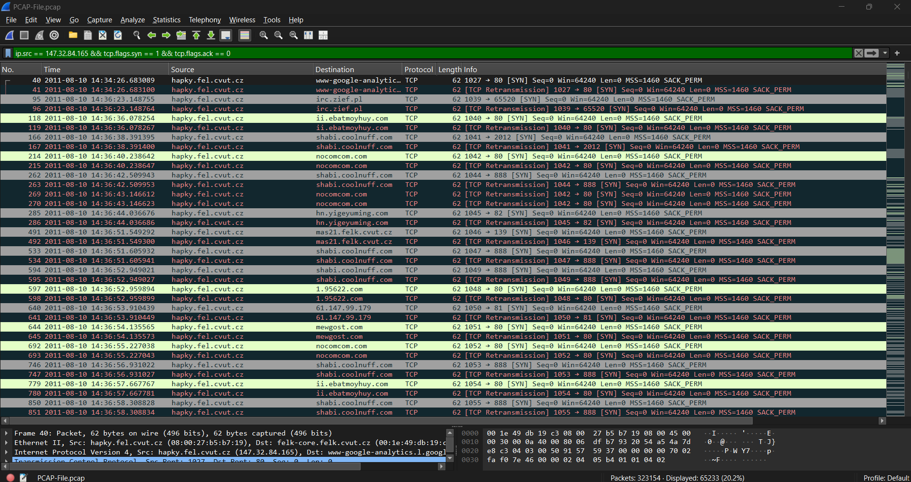

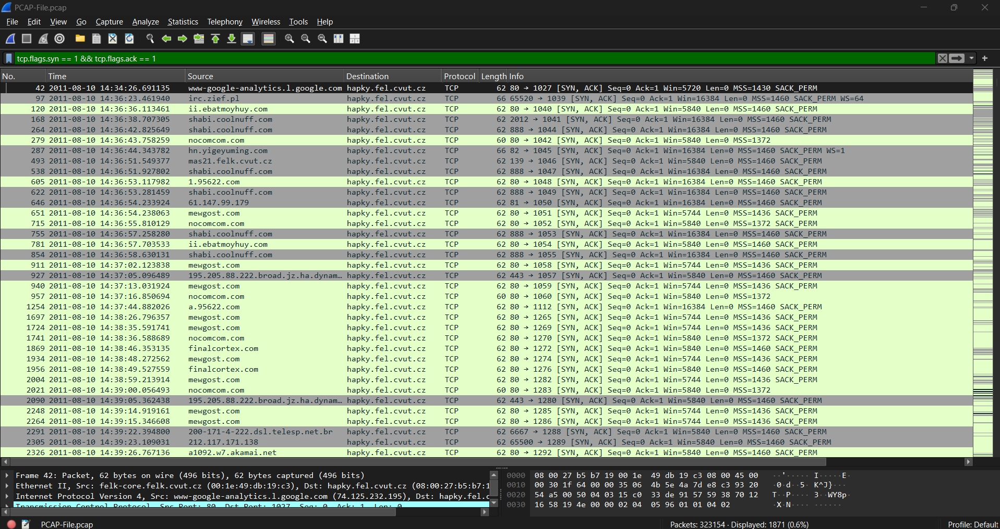

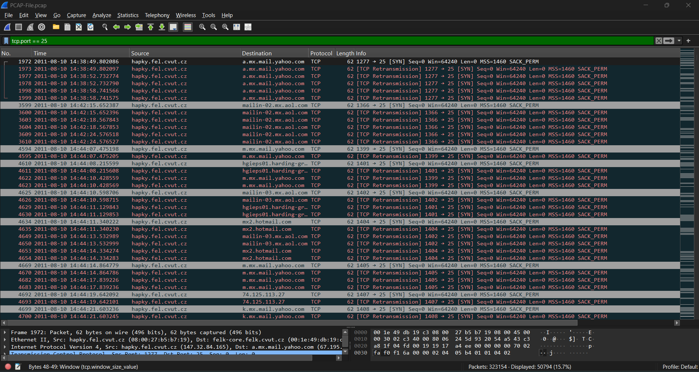

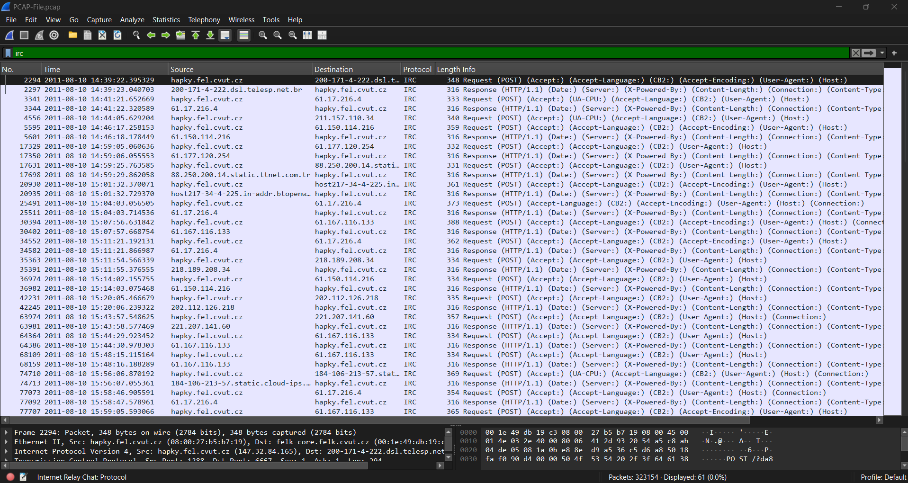

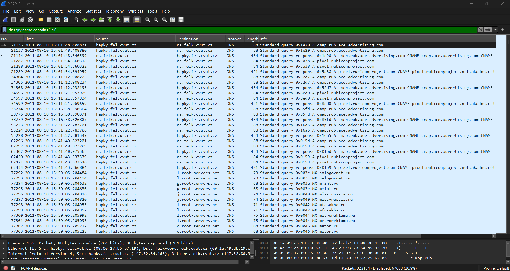

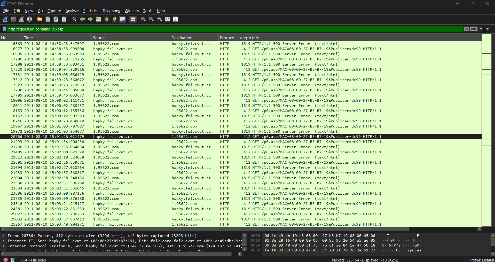

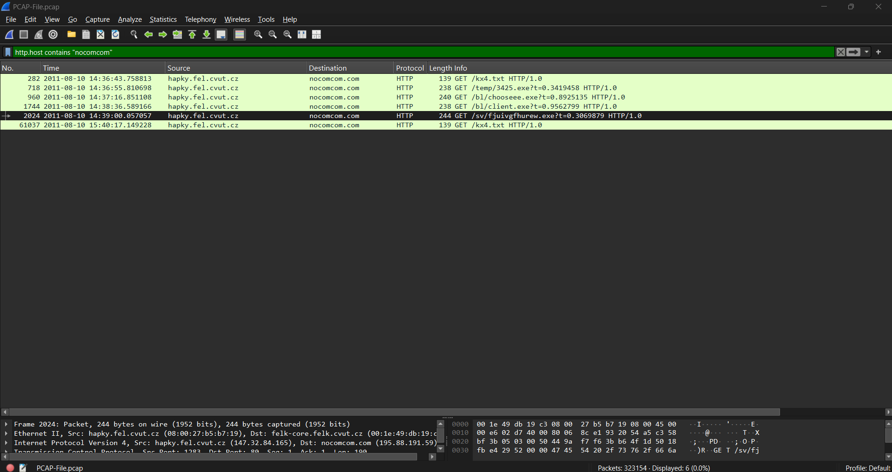

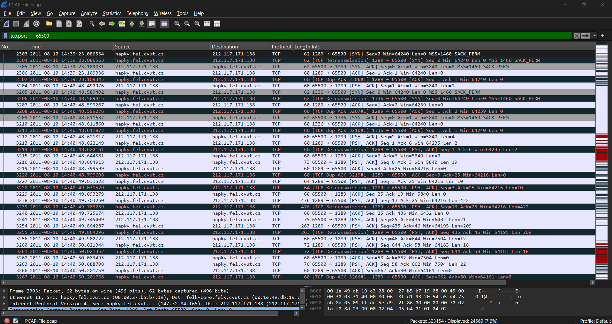

### Attack-type checks

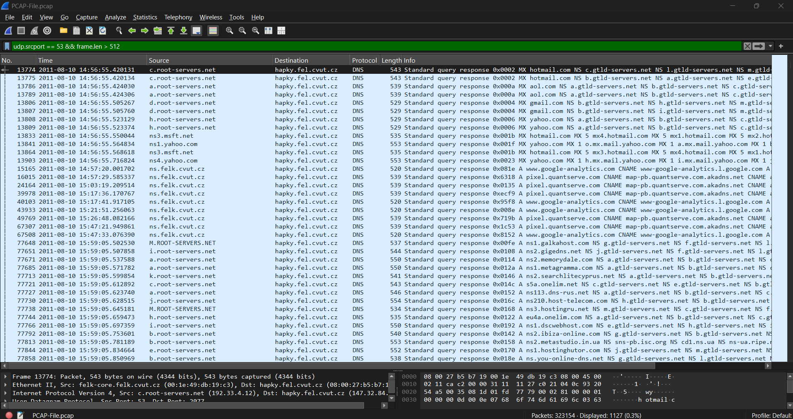

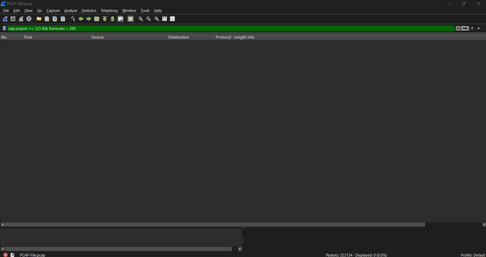

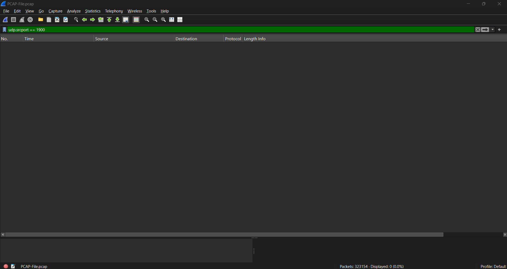

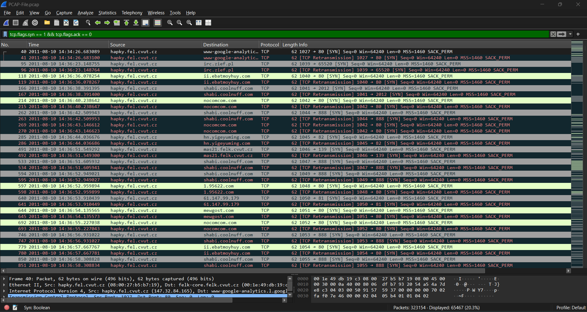

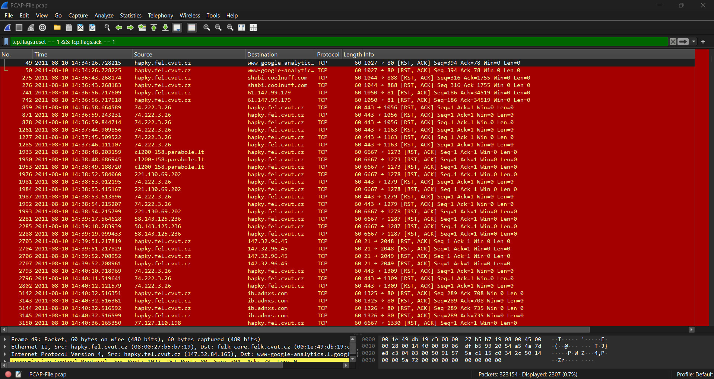

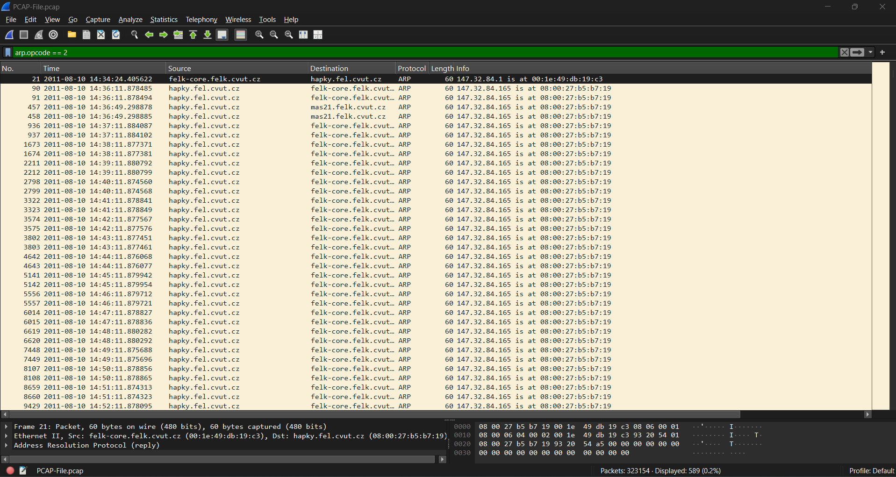

### Reference checklist

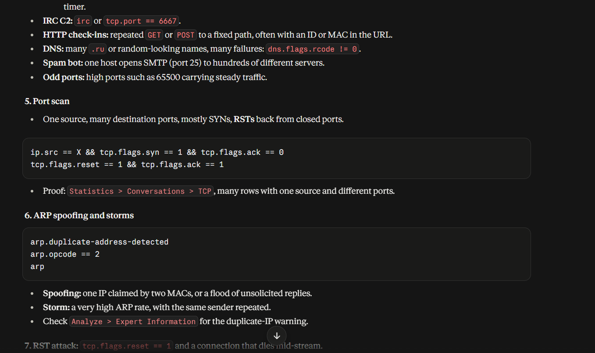

## Detection

- **Spam bot:** a host that is not a mail server opening SMTP (25) to many distinct destinations. Log sources: firewall egress logs, Zeek `conn.log` or `smtp.log`. Fix: block outbound 25 from everything except the mail relay.
- **C2 check-ins:** repeated requests to one fixed path with a host identifier in the query string (`MAC=`, `Publicer=`), especially when every response is an error. Proxy or Zeek `http.log`: group by `uri` path and count per source.
- **Executables over HTTP:** `.exe` downloads from a bare domain with a cache-busting `?t=` parameter, using HTTP/1.0 (an unusual version for a browser). Proxy or EDR download logs.
- **Non-standard port with steady traffic:** long-lived TCP to a high port such as 65500 with small periodic payloads.
- **Mass unanswered SYNs:** one internal host producing thousands of unanswered connection attempts is itself an alert, independent of payload.

Syntax-checked only, not run against real logs:

```yaml
title: Outbound SMTP Connection Attempt
id: 2d7c9b34-6e1a-4a85-b3f0-5c8e14a97d62
name: outbound_smtp_connection
status: experimental
description: Any outbound TCP connection to port 25, as logged by Zeek. Base rule for the spam-bot correlation below.
logsource:
    product: zeek
    service: conn
detection:
    selection:
        proto: tcp
        id.resp_p: 25
    condition: selection
level: informational
---
title: Possible Spam Bot - Outbound SMTP to Many Distinct Servers
id: f0a3e81b-9c44-4d2e-8b17-6a5d29c0e3b8
status: experimental
description: One internal host connects to SMTP on many distinct external servers within ten minutes. Exclude your legitimate mail relays before use.
correlation:
    type: value_count
    rules:
        - outbound_smtp_connection
    group-by:
        - id.orig_h
    timespan: 10m
    condition:
        gte: 50
        field: id.resp_h
tags:
    - attack.command_and_control
    - attack.t1071.003
falsepositives:
    - Legitimate outbound mail relays and mail gateways
level: high
```

ATT&CK, mapped from the traffic visible in the screenshots (not stated in my notes): [T1071.001 Web Protocols](https://attack.mitre.org/techniques/T1071/001/) for the HTTP check-ins, [T1571 Non-Standard Port](https://attack.mitre.org/techniques/T1571/) for traffic on 65500 and HTTP-style traffic on 6667, and [T1105 Ingress Tool Transfer](https://attack.mitre.org/techniques/T1105/) for the `.exe` downloads.

## Tools used

Wireshark display filters and the packet list and detail panes.

