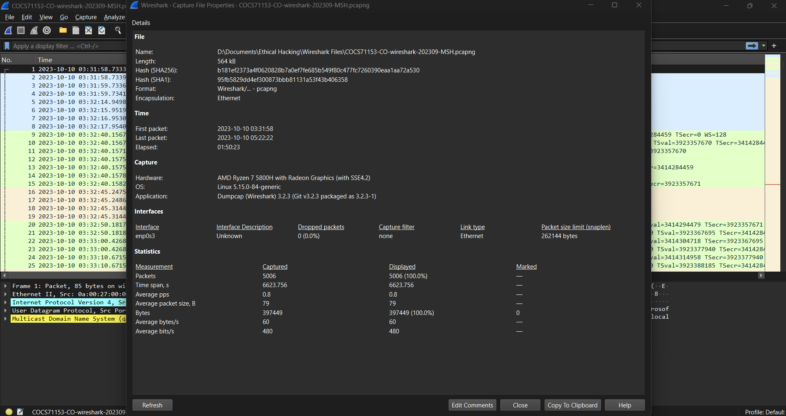
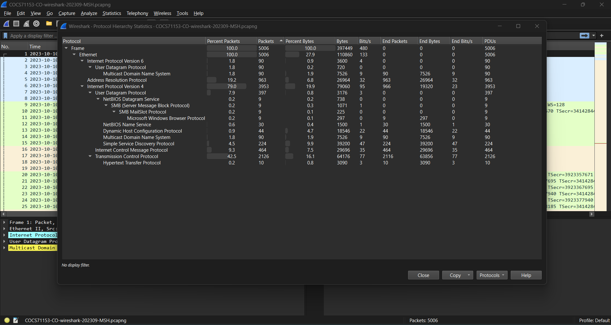
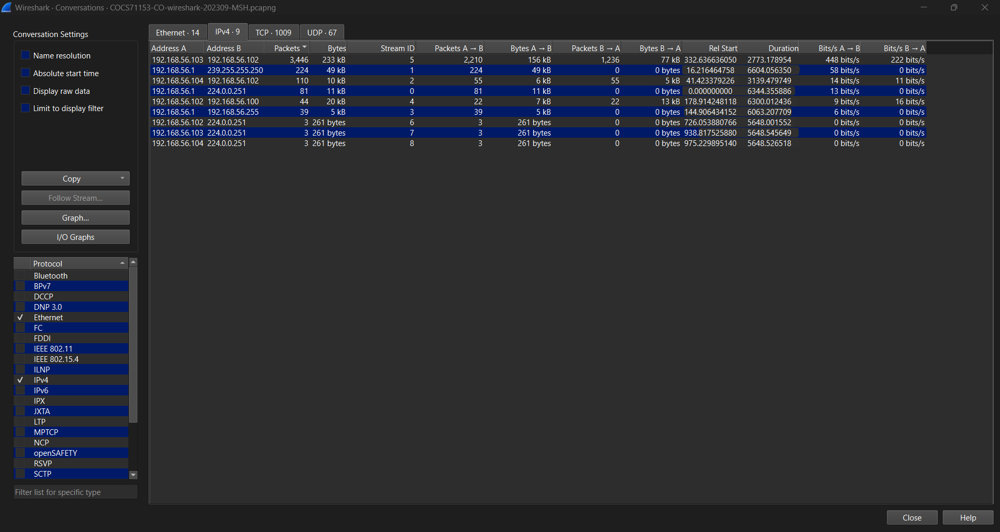
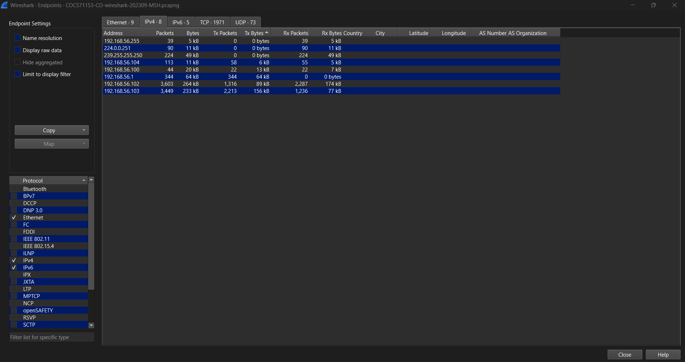
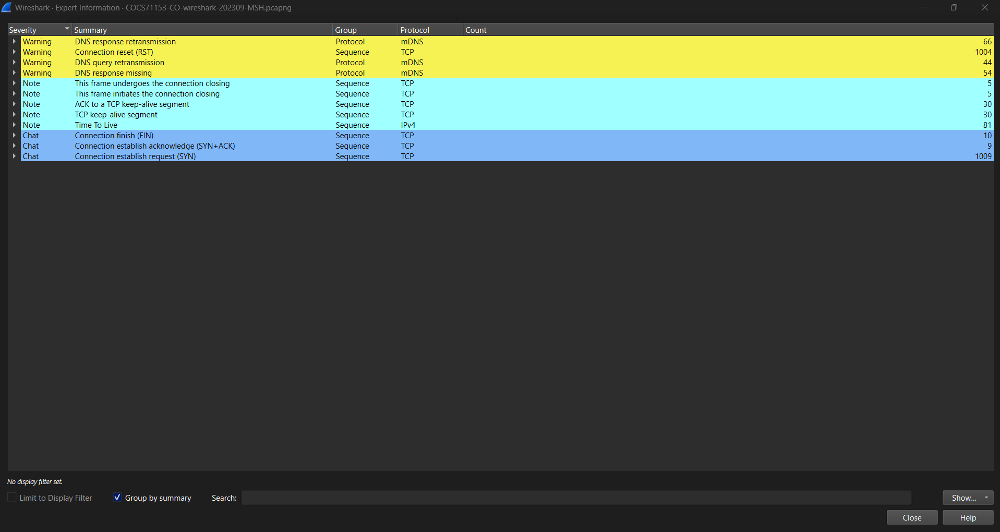

# PCAP Triage Workflow: Five Wireshark Views to Orient on an Unknown Capture

## Objective

Build a repeatable first-five-minutes routine for any unknown packet capture: answer *when*, *what*, *who*, *who most* and *what broke* using only Wireshark's Statistics and Analyze menus, before touching a single display filter. Practised on a university-module capture (`pcapng`, Ethernet, 192.168.56.0/24 host-only network) as exam preparation for my Ethical Hacking module. Extra-practice track, not roadmap curriculum.

## What I did

I wrote the routine as five questions, each tied to one Wireshark window:

| # | Question | Where |
|---|---|---|
| 1 | When? | Statistics > Capture File Properties |
| 2 | What? | Statistics > Protocol Hierarchy |
| 3 | Who? | Statistics > Conversations |
| 4 | Who most? | Statistics > Endpoints |
| 5 | What broke? | Analyze > Expert Information |

1. **When:** read the first and last packet times, the elapsed time, the interface and link type, the packet count, and the average packets and bits per second.
2. **What:** opened Protocol Hierarchy with every tree expanded and compared the *% Packets* column against *% Bytes*.
3. **Who:** opened Conversations, ticked only Ethernet, IPv4, TCP and UDP, then sorted by number of packets.
4. **Who most:** opened Endpoints and compared Tx (sent) against Rx (received) packets per address.
5. **What broke:** opened Expert Information and read the warnings first (retransmissions and resets).

## What I found

- **When:** 5,006 packets over 01:50:23 (first packet 2023-10-10 03:31:58, last 05:22:22), captured on `enp0s3` over Ethernet with no capture filter and 0 dropped packets. The average rate is only 0.8 packets/s, so this is a quiet capture, not a flood.
- **What:** IPv4 is 79.0 % of packets, ARP 19.2 % (963 packets) and IPv6 1.8 %. Inside IPv4, TCP is 42.5 % of all packets (2,126), ICMP 9.3 % (464), UDP 7.9 % (397, including 224 SSDP, 90 mDNS, 44 DHCP and 30 NetBIOS name service). Only 10 packets are HTTP.
- **Who:** nine IPv4 conversations. One pair dominates: 192.168.56.103 and 192.168.56.102 exchanged 3,446 packets (233 kB) over about 2,773 s. The next largest are 192.168.56.1 to 239.255.255.250 (224 packets, SSDP multicast) and 192.168.56.104 to .102 (110 packets). The TCP tab holds **1,009** conversations, which is very high for three active hosts.
- **Who most:** 192.168.56.102 is the busiest endpoint (3,603 packets: 1,316 sent, 2,287 received). 192.168.56.103 is almost its mirror image (3,449 packets: 2,213 sent, 1,236 received), so .103 sends nearly twice what it receives and .102 receives nearly twice what it sends.
- **What broke:** Expert Information lists **1,004** TCP "Connection reset (RST)" warnings, against **1,009** connection requests (SYN), only **9** SYN+ACK acknowledgements and 10 FIN closes. The only retransmission warnings are mDNS ones (66 DNS response retransmissions, 44 DNS query retransmissions, 54 DNS responses missing), not TCP.

My notes do not name the attack in this capture. The numbers alone (about 1,009 connection attempts, 9 accepted, 1,004 reset, between two hosts) are consistent with one host probing many ports on another, which would explain both the 1,009 TCP conversations and the Tx/Rx asymmetry. That is an inference from the counts; I did not open the packets to confirm which ports were probed.

## How I found it



Step 1: the time window and capture rate.



Step 2: protocol mix. ARP and TCP dominate the packet count.



Step 3: one conversation (.103 and .102) carries 3,446 of 5,006 packets.



Step 4: Tx and Rx comparison per address.



Step 5: 1,004 resets against 1,009 SYNs and only 9 SYN+ACKs.

## Detection

A port scan like the one these counts suggest leaves three signatures a defender can alert on without reading payloads:

- **Many distinct destination ports from one source in a short window**, mostly SYN with no completed handshake.
- **Many RSTs from the target** (closed ports answer with RST) against very few SYN+ACKs (open ports).
- **Tx much greater than Rx for the scanner**, and the reverse for the target.

Log sources: Zeek `conn.log` (`conn_state` of `REJ` or `S0`), firewall deny logs, or flow records. Wireshark filters to confirm: `tcp.flags.syn == 1 && tcp.flags.ack == 0` and `tcp.flags.reset == 1 && tcp.flags.ack == 1`, then Statistics > Conversations > TCP for one source with many different ports. Syntax-checked only, not run against real logs:

```yaml
title: Many Rejected Connections to Distinct Ports From One Source
id: 4b1f6a52-0c7e-4f1d-9d57-2a3e8c5b9f10
name: rejected_tcp_connection
status: experimental
description: A TCP connection that was rejected (RST) or never answered, as logged by Zeek. Used as the base for the port-scan correlation below.
logsource:
    product: zeek
    service: conn
detection:
    selection:
        proto: tcp
        conn_state:
            - REJ
            - S0
    condition: selection
level: informational
---
title: Possible TCP Port Scan - Many Distinct Destination Ports From One Source
id: c3d9e7a1-5b82-4e3a-8f46-91a2b7d04e55
status: experimental
description: One source triggers rejected or unanswered connections to a large number of distinct ports on the same destination within five minutes.
correlation:
    type: value_count
    rules:
        - rejected_tcp_connection
    group-by:
        - id.orig_h
        - id.resp_h
    timespan: 5m
    condition:
        gte: 100
        field: id.resp_p
tags:
    - attack.discovery
    - attack.t1046
falsepositives:
    - Authorised vulnerability scanners
level: medium
```

ATT&CK: [T1046 Network Service Discovery](https://attack.mitre.org/techniques/T1046/) (consistent with the counts, not confirmed from packet contents).

## Tools used

Wireshark (capture made with Dumpcap 3.2.3): Capture File Properties, Protocol Hierarchy, Conversations, Endpoints and Expert Information.

